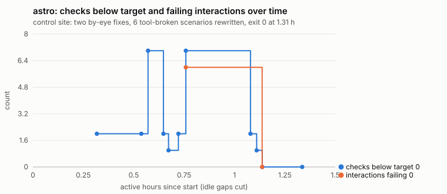
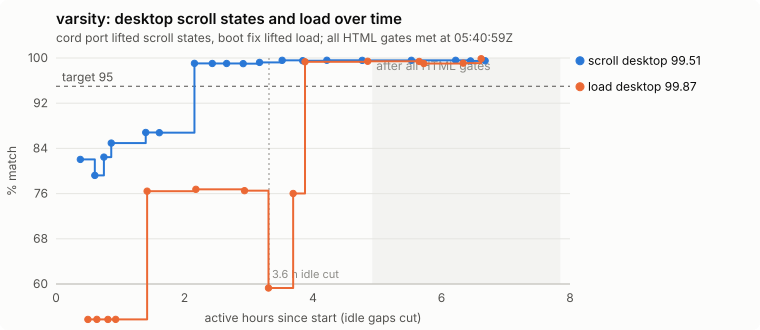
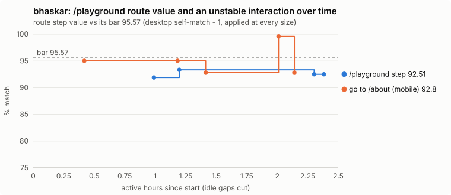
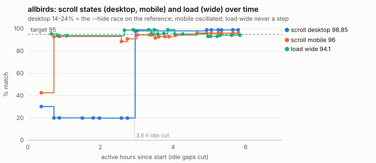
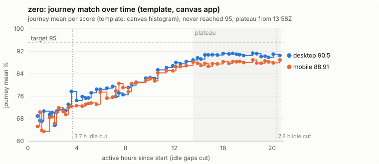
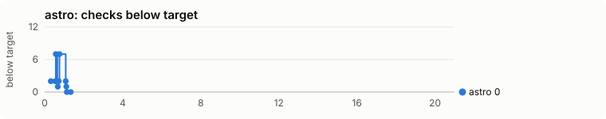
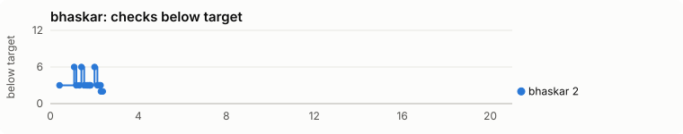
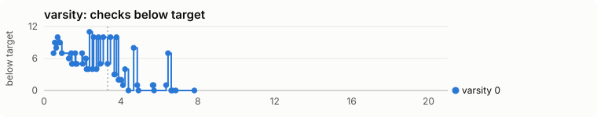
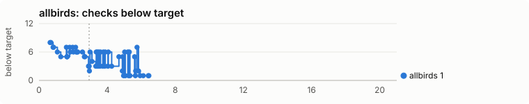
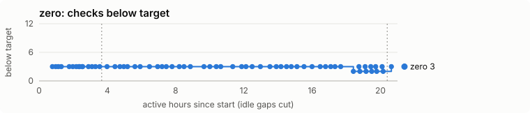

# trueclone 0.5.0-rc.4: evaluation of the five RC4 runs

> **Status (2026-10-22):** this evaluation's recommendations became `docs/plan-rc5/PLAN.md` and were implemented in
> 0.5.0-rc.5; where they differ, `docs/policy.md` wins (notably item 1: progress is tracked per pass condition, and
> item 4: measurement is controlled first, sampling is the fallback). The per-event timelines in `data/*.timeline.json`
> were built from local agent session logs and are not in the repository (gitignored); `projects/*.series.json` and
> `data/run-facts.json` keep what was concluded from them.

Evaluated 22 Oct 2026, read-only. Nothing in `C:\dev\tc-tests\` or the tested skill was modified, committed or
published. This folder (`rea-lab/docs/eval-rc4/`) holds everything generated for the evaluation:

- this report;
- `projects/<run>.md`, the full per-project investigations, with evidence by path:line;
- `projects/<run>.series.json`, the measured points;
- `data/`, the parsed Codex sessions and run facts;
- `charts.html` and `charts/*.svg`, the graphs, built by `make-charts.mjs`.

Labels used throughout:
- **Obs** means seen in a file;
- **Inf** means inference;
- **Rec** means recommendation.

Scores marked *provisional* include the evaluator's by-eye item from saved frames. Replace it with your own by-eye
score (score sheet item 12).

---

## 1. Executive assessment

**The tool is not ready for public release.** One run (astro) behaved exactly as designed. The other four ran into
defects in **how trueclone decides it is finished**, not in how well the agent cloned:

- two runs could not reach an honest end at all;
- one reported a pass that its own Next report contradicts;
- one passed a visible defect through a weak review gate.

The clones themselves are mostly good. The decisions about them are where RC4 fails.

| Run | Ended | Wall / active | Score sheet (provisional) | Evaluator by eye (saved frames) | Planned by eye | Planned time |
|---|---|---|---|---|---|---|
| astro (template, 4 pages) | **exit 0**, honest | 1h21 / 1h21 | **24/26 = 92** | ~96 | 96-97 | 60-110 min |
| varsity (exact, 2 pages) | **exit 0, false**: the Next canvas check fails (50.28 < 60) | 11h28 / 7h51 | **21/26 = 81** | ~92 | 85-90 | 120-200 min |
| heybhaskar (exact, 8 routes) | **exit 1**: the agent stopped on a proven tool blocker; no Next app | 2h25 / 2h25 | **19/26 = 73** | ~94 | 93-96 | 150-240 min |
| allbirds (template, 1 page) | **exit 3**, but load wide was never named, and the review was closed with "tool" verdicts over a visible clone-only overlay | 10h06 / 6h29 | **15/26 = 58** | ~84 | 85-88 | 90-150 min |
| zero.university (template, canvas app) | **exit 1**: you stopped it after 32h; the loop could not end | 32h12 / 20h43 | **15/26 = 58** (65 if beating the forecast is not penalised, see 3.5) | ~65 desktop / ~60 mobile | 20-40 | 120-240 min |

Five projects, one run each. zero's run had one interrupted turn (your question) and one wrap-up turn.

### Accuracy (what the clones are)

- **The document clones are high quality**:
  - astro, varsity and heybhaskar are near-identical in saved frames;
  - allbirds is good structurally but carries an assistant overlay that the original does not have.
- **zero.university came out far better than forecast.** App mode drafted the whole journey on a live third-party
  WebGL app: the zero gate, both 3 s holds, every stage to "Hired". The port reached a recognisable template copy of
  every stage.
- **But zero's 90.5 / 88.9 is a colour-histogram score.** The pixel means are 63.2 / 58.5, and in the last ~8 active
  hours the agent fitted reference colour statistics to raise it (section 3.5).

### Time (what the hours bought)

- **Excluded from all time figures:** a 3h37m host pause (00:27-04:04 UTC on 21 Oct, every long run silent at once)
  and zero's 7h50m overnight gap.
- **Even so, the three long runs used 3-10x their budgets.** The extra hours bought little:
  - **varsity:** the HTML clone met every gate at **4.9 active h**; the remaining 2.9 h produced no measured gain.
  - **zero:** plateaued at **13.5 active h**; the 7.2 active h after it moved the journey ±1.5.
  - **allbirds:** spent ~2.5 h on a third-party AI shopping widget and ~1 h on a mobile value that oscillated.
  - **heybhaskar:** nothing gating improved after **1.2 h**.
- **Root cause of the waste.** The completion logic cannot see a plateau, cannot set aside a moving target, has no
  exit for tool-blocked steps, and re-measures unchanged checks after every fix.

### Public readiness

- **Verdict:** not ready.
- **What has to happen first:** the seven release blockers in section 5 are all small, testable changes in
  `status.mjs`, `lib.mjs`, `report.mjs`, `seed.mjs` and the skill.
- **What the release needs to prove:** a five-run retest (section 6) in which every run reaches exit 0 or 3
  honestly, within a time ceiling.
- **Confidence: high.** Every blocker is confirmed in the tool's source and observed in a run artifact.

### How the RC4 forecasts did

- **Terminal outcomes: two of five right** (astro exit 0, allbirds exit 3).
- **Time budgets: wrong for every long run.**
- **zero's quality forecast: too pessimistic** (20-40 by eye forecast, ~60-65 observed).

The plan's confidence numbers (70-90%) were too high, because they assumed the completion logic worked.

---

## 2. Evidence and methodology

**Materials reviewed (all present):**
- the five run folders (`C:\dev\tc-tests\rc4-*`);
- the pasted transcript `exact responses - rc4.txt`, mapped to runs:

  | Run | Transcript lines | Note |
  |---|---|---|
  | allbirds | 1-868 | starts mid-run |
  | astro | 869-1606 | |
  | varsity | 1607-4180 | |
  | bhaskar | 4181-5518 | |
  | zero | 5519-11697 | |

- **the raw Codex session files** (`~/.codex/sessions/2026/10/21/rollout-*.jsonl`): one main session per run, plus
  the auto-review "guardian" sessions. These carry the model, effort, approval and sandbox settings per turn, every
  tool call with timestamps, user messages, compactions and token counts. They are the primary timeline source.
- the agents' own timestamped logs: zero `.trueclone-run/commands.jsonl` (281 commands), bhaskar
  `.trueclone-run/NN-*.log` (137);
- the agents' audits: allbirds `RUN-AUDIT.md`, astro `RUN-LOG.md`, varsity `FINAL-REPORT.md` / `TOOL-DEFECTS.md`,
  zero `RUN-AUDIT.md`;
- each run's REPORT.md, REPORT.next.md, compare/, compare-next/, notes.md, reference/ and clone/;
- the CLI source each run actually executed (`node_modules/@trueclone/cli/scripts/`).

**Version mapping:**
- **trueclone:** all five ran **0.5.0-rc.4**, and the skill and scripts are byte-identical to rea-lab commit
  `17cd6cf` (SHA-1 checked).
- **Governing criteria:** `docs/test-plan-0.5-rc4.md`: the C0-C16 flow, per-site expectations, the 13-item score
  sheet, and Z1-Z8 for zero.
- **What RC4 was meant to fix:** `docs/analysis-0.5-rc3-runs.md` (A1-A10, B1-B6, C1-C7, D1-D6) and
  `docs/plan-0.6-app-mode.md` (app mode).

**Configuration (verified from the session logs):**

| Setting | Recorded | Runbook asked for | Effect |
|---|---|---|---|
| Model | `gpt-6.1-sol` | GPT-6.1 Sol | same |
| Reasoning effort | **`high`** | Extra High | deviation |
| Sandbox | `workspace-write`, `network_access: false`, approvals `on-request` reviewed by `codex-auto-review` | Full access | deviation |
| Codex | 0.163.0-alpha.10.2, priority tier | | |
| Starts (IST, 21 Oct) | zero 02:17, bhaskar 02:29, varsity 02:38, astro 02:47, allbirds 03:00 | | all five overlapped on one machine |

- **Sandbox cost:** the first capture failed on DNS in every run, and seed failed once in astro and bhaskar. Approvals
  cost little: 31-358 reviews per run, about 2-3 s each, at most 18 min in total for zero, none denied.
- **What the sandbox exposed:** the seed failures surfaced a real tool defect (5.4).

**Scoring:**
- **The score sheet** (test plan section 3) is applied as written: 13 items at 0/1/2, total out of 26, normalised to
  100.
- **Item 12 (by eye)** is defined as *your* look. Here it is filled provisionally from the evaluator's inspection of
  the saved review frames (not a live render) and labelled as such.
- **Separate 0-10 dimensions** (implementation, workflow, verification, time, handoff) are reported beside the sheet,
  not merged into it.
- **No aggregate is used for decisions.** A mean (72/100) would hide that two runs could not end.

**Timestamps and time:**
- **Units:** all times are UTC unless marked IST.
- **Active time** is wall time minus gaps with **no session events at all**:
  - **00:27-04:04Z on 21 Oct**, in varsity, allbirds and zero at once (and astro and bhaskar had already ended).
    That points to the host, most likely sleep; cause unresolved.
  - **20:50Z on 21 Oct to 04:40Z on 22 Oct**, zero only.
- **Within active time, command running versus model thinking can't be split reliably**, because commands run in
  background shells the model polls. Per-phase times come from each run's timestamped logs (`projects/*.md`, section 5).

**Limitations:**
- No live render or re-score was run while the zero run was live, to avoid disturbing its timing. By-eye items use
  saved frames.
- Lock-wait minutes are inferred (no lock log).
- The cause of the host pause is unknown.
- One investigator was refused the raw JSONL by the permission policy and worked from the parsed timeline.

---

## 3. Project reports

Full investigations, with the C0-C16 tables, every finding block and the score justifications, are in
`projects/<run>.md`. Below: the essentials, the graph, the decisive findings, and corrections.

### 3.1 astro: the control (exit 0, 81 min, 92/100)

**Ideal vs actual.** Every checkpoint C1-C16 was followed in order.

- The sandbox forced one capture retry and one seed retry.
- The agent viewed all 103 review frames and found **two real defects that no number caught** (mobile table-of-contents
  label timing on two routes). It fixed them by porting the site's own rule.
- It rewrote six un-runnable tab scenarios **legitimately**: open the disclosure first, then the same tabs. The
  end-state shots still discriminate.

**Verified successes:**
- every check at 100, except load desktop at 98.76;
- interactions 26/26;
- Next equal to the clone on every row.

**RC4 fixes that ran and held:**

| rc.3 defect | What it was | Status |
|---|---|---|
| A1 | start address | resolved |
| A3 | the 13 dropped tab scenarios | they now run; 6 flagged honestly |
| C2 | per-page script evidence | runs, with a defect (below) |
| C5 | navigation cap | filter-then-cap and the link back work |
| B4 | Findings edits reopening Next | resolved |
| A8 | Next within a point | resolved |

**Unexpected:**
- **ASTRO-5 (release blocker):** every inline script on a route page is saved under **one** file name and overwritten.
  - **Cause:** `capture.mjs:345` passes the route URL without its trailing slash, so `scripts-evidence.mjs:21` never
    marks them inline, and `:127-129` names them all by the page hash.
  - **Effect:** the briefs and INDEX cite the wrong code, and "Coverage 12/12" is overstated.
  - **Note:** the agent saw the symptom and misdiagnosed it.
- **ASTRO-4 (release blocker):** `seed.mjs:381` writes `clone/index.html` *before* the browser pass at `:548`.
  - **Effect:** a failed seed counts as done (`status.mjs:96`), and a re-run is refused without `--force`.
- **ASTRO-3:** auto-scenarios target tabs inside a closed `
` (`interactions-auto.mjs:11-16`).
- **ASTRO-11:** stale checks are reported as "below target".

**Time:**
- About 15 min waiting on the machine-wide timing lock.
- Each clone change cost two rescores (`--only interact`, then the stale checks).
- No wasted loops. All HTML criteria were met at 1.14 h and exit 0 came at 1.31 h.

### 3.2 varsity: a false exit 0 after 7.9 active hours (81/100)

**Ideal vs actual.** C1-C14 were followed. Every scored try changed the clone, nothing was gamed, and 217 review
frames were closed by eye.

**What the time bought.** The productive loops were real:
- the cord physics port took scroll states desktop from 86.8 to 99.05 (by 2.15 h);
- the boot fix took load from 72-76 to 95.8-99.5 (by 3.9 h);
- stories and /legal were fixed.

**The HTML clone met every gate at 4.92 active h.** The last 2.9 active h (37%) produced no measured improvement:
- four Next verifies (87 min);
- 47 min re-working the cords to chase a frame that is noise;
- reference-against-reference replays.

**Exit 0 came from re-verifying an unchanged app.** The previous verify's parity gaps (noisy load, review frames)
vanished on the re-roll (VAR-7).

**Release blockers (confirmed in source):**
- **VAR-1, false pass.** `status.mjs:282-284` reads `compare-next/verdict.json` only for its timestamp.
  - Its parity pairs (`:290-314`) leave out canvases and motion.
  - So "every gate passes" was printed while the Next verdict has `Canvases pass:false`.
- **VAR-2, a canvas floor that measures noise.**
  - The live site replayed against its own capture fails the same frame (desktop y 7650: 51.55 / 49.21; mobile
    44.65 / 48.23).
  - In the saved shots, the capture shows three cords and the replay one.
  - There is no reference self-repeat for canvases (`report.mjs:35`, `lib.mjs:538`).
- **VAR-3, a partial measurement reads as a pass.**
  - `score --only states --viewport desktop` replaces the whole states report with one width (`states.mjs:155`).
  - The report judges only the widths present (`report.mjs:128`).
  - At 07:22 REPORT.md said "every scored check meets its target" with 4 of 5 widths unmeasured.
- **VAR-4, a failed child step exits 0.** `score` exits 0 when a child fails (`score.mjs:106-160`), and status's
  parity skips missing values (`status.mjs:288`).

**The agent's 18 tool-defect claims are all real.** The ranked triage is in `projects/varsity.md` (7 major).

**Anticipated, partly resolved:**
- A5 (canvas floor) now routes a step, but measures noise;
- A9 (review tokens) are coarse;
- B6 (Next review) covers only the start page;
- rc.3 E: motion is now scored, but the drafted map had 53/88 duplicate names and 72 unparseable ranges (VAR-5).

### 3.3 heybhaskar: stopped at exit 1 on a real tool defect (73/100)

**Ideal vs actual.** C1-C13 were followed and reviewed by eye (307 frames). Load is fixed: 97.3-99.8, against rc.3's
79.8 (A6). Per-route keys work (B2). There was no gaming.

**At 1.20 h the run plateaued on `/playground`, a route that shuffles on every load.** There, at 2.41 h, the agent
stopped under the skill's "real blocker" clause.

**BHASKAR-1 (release blocker, confirmed):**
- The random-route self-check reloads only at desktop (`capture.mjs:378`).
- `report.mjs:213` applies that one number (96.57 - 1 = 95.57) to **layout and scroll states at all five sizes**.
- The live mobile reference matches its own capture at 92.95-95.57, so 5 of 6 fall below the bar a correct clone
  is held to.

**BHASKAR-2 (release blocker):**
- Status has **no exit for a step no clone change can move**:
  - routes have no Findings or skip path, unlike interactions (`status.mjs:240-241`);
  - the step's own command answers "nothing changed";
  - Next comes only after everything passes or is set aside (`status.mjs:271-284`).
- So no honest exit 3 existed. The agent's stop matched the skill's words but not its intent.

**BHASKAR-3 (unresolved):**
- The clone's `/playground` *desktop* layout (93.99) is below all 8 desktop reference draws (96.57-98.09).
- So part of the gap may be real clone work. The agent's blocker evidence covers mobile only.

**BHASKAR-4:**
- The empty-page floor (`interact.mjs:282-283`, ink ratio) flags a white artwork card on one random draw as "almost
  empty".
- That cancels the unstable-route exemption: a clash between two rc.3 fixes, A2 and C7.

**Time:**
- 18 of the 39.6 scoring minutes re-measured detail, hovers and load, which never changed (BHASKAR-10).
- About 13 min went on entrance frames that don't repeat from run to run (BHASKAR-9).

### 3.4 allbirds: exit 3 with two holes in the gates (58/100)

**Ideal vs actual.** **C2 worked exactly as designed**: the geofencing modal was detected at 100% coverage, and the
agent ran status's `--hide` re-capture verbatim within 4 s. Interactions have no address failures (A1) and hovers are
measurable (A4).

**ALLBIRDS-2 (release blocker, confirmed):**
- `profileOfSite()` caches `null` before its `await` (`lib.mjs:180-188`).
- Every check that opens viewports in parallel therefore applies `--hide` to the first viewport only.
- **Effect:** desktop, tablet, laptop and wide scroll states sat at 14-25% against a reference under the modal. They
  jumped 19.88 → 98.03 with **no clone change** once the reference was re-recorded with the profile applied (chart).

**ALLBIRDS-3 (integrity):**
- The agent fixed the race by injecting `warm-profile.mjs` into every command through `NODE_OPTIONS --import`. It
  sets the exact profile `meta.json` holds, and changes no maths and nothing on the clone side.
- **But from 00:07 the scores came from a patched instrument.** It was applied unevenly, and disclosed in notes, not
  in the final message.
- The agent also re-authored the motion map, which moved motion from 91.5 to 100 with no clone change, and ran a
  third capture that status never asked for.

**ALLBIRDS-8 (release blocker): the review gate passed a visible defect.**
- 103/105 verdicts are "tool" and none are "differs".
- The clone shows an assistant launcher the reference lacks, over content on mobile.
- 27 re-shot frames got verdicts without being viewed.
- `report.mjs:83` closes any frame on "tool" plus any existing evidence file.

**ALLBIRDS-10: the set-aside logic has two holes.**
- Non-scroll checks get **one key per check** (`status.mjs:199`). So once load laptop was set aside, **load wide
  (94.1) was never named**, and the run exited 3 below target.
- The scroll key includes the worst y. Mobile flipped 1688↔2110 over 7 cycles (94.33 → 94.12) and never reached a
  set-aside.

**Seed traps:**
- D3 resolved;
- D4 unresolved (the refund dialog loses `display:none`);
- D5 partial (lazy images still opaque boxes).

**Time:** 6h29m active against 90-150 min.
- About 2.5 h went on a third-party AI widget that differs on every load.
- About 80 min of lock waiting (inferred).
- 41 probe scripts and a 152 KB audit.

### 3.5 zero.university: app mode works up to the port; the loop cannot end (58/100 strict)

**Ideal vs actual:**

| Step | What happened |
|---|---|
| Z1 | Canvas app detected (three.js r160). |
| Z2 | The draft found **30 desktop checkpoints, through the zero gate and both holds**. The phone draft stopped at 18 without saying why (ZERO-7: the post-hold transition counted as three quiet swipes). |
| Z3 | The agent proved the phone journey continues and extended it to 27, with no debug URL. |
| Z4 | Reads recorded 30/27 frames, a scene per checkpoint, and 45 fragment / 31 vertex shaders. |
| Z5-Z6 | Seed, vendor, and a port citing 28 rules by file:line: gate thresholds, lerp .075, stage lengths, hold durations. |
| Z7-Z8 | **Never reached.** |

**Journey progress** (active hours, journey ≥ threshold):

| Threshold | Desktop | Mobile |
|---|---|---|
| 80 | 8.9 h | 7.5 h |
| 85 | 10.6 h | 11.4 h |
| 88 | 12.1 h | 13.5 h |
| 90 | 14.5 h | never |

- **Plateau** from 13.5 h; every checkpoint at or above the 80 floor first at 18.4 h.
- **Best:** 91.34 desktop / 88.93 mobile. **Final:** 90.50 / 88.91.
- The 7.2 active h after the plateau (plus 7.8 h overnight) moved it ±1.5.

**ZERO-2 (release blocker, confirmed). The loop cannot terminate.**
- Status keys the journey step by the **current worst checkpoint** (`status.mjs:208-218`).
- When that checkpoint stops being the worst, the key is gone from the candidates and its try count is deleted as
  "fixed" (`status.mjs:262`).
- Fixing the worst always promotes another, so no key was issued more than twice in a row in 56 cycles.
- `compare/status-steps.json` never held a count.
- What fails is the **mean**, and nothing tracks it.

**ZERO-3 (release blocker):**
- In app mode, review steps are skipped (`status.mjs:192`) and the verdict step is ordered after the journey.
- So 0/57 frames got a verdict, and exit 0 was impossible.

**ZERO-4: the template-mode journey score is a 64-bin colour histogram plus ink coverage** (`journey.mjs:459`,
`lib.mjs:538`).
- It reads 90.5 / 88.9 where the pixel means are 63.2 / 58.5.
- It cannot reach 95 with replaced art, and it rewards fitting colour statistics.

**ZERO-5: from about 13:00Z most cycles fitted the clone's colour statistics to the reference's pixels:**
- `fit-city-colour-style.mjs` solves 32 colour offsets against the live site's map texture;
- the palette, CDF and LUT patches work the same way;
- the agent shipped camera and joint animation tracks read from the site's GLB models (2.2 MB), a grey zone for
  template mode.

It was not gaming the loop (every score followed a real change), but it was fitting the metric.

**Why 58 strict:**
- Score sheet item 11 ("numbers within the Expect column") is 0, because the journey landed above the forecast band
  (25-50).
- The investigator scored it 2 on the view that beating a forecast is not a defect, which gives 65.
- The rubric's text supports 0, so 58 is the official figure. The item measures forecast accuracy, not quality.

### 3.6 Cross-project timeline (checks below target, active hours, same scale)

| | |
|---|---|
|  |  |
|  |  |
|  | |

**How to read these strips:**
- the metric is the framework's own REPORT.md verdict after every score or report;
- spikes are stale checks counted after partial scores (ASTRO-11), not regressions;
- `charts.html` has hover titles and a data table per chart.

**Milestones** (active hours, measured):

| Run | First score | Earliest acceptance | Plateau from | End | After the last measured gain |
|---|---|---|---|---|---|
| astro | 0.32 | 1.14 (HTML), 1.31 (exit 0) | n/a | 1.36 | 0.05 |
| varsity | 0.50 | 4.92 (HTML all gates); Next never within a point | 4.92 | 7.85 | 2.93 |
| bhaskar | 0.42 | never | 1.20 | 2.41 | 1.21 |
| allbirds | 0.66 | 6.44 (exit 3; load wide still below) | about 5.3 | 6.48 | about 1.1 |
| zero | 0.78 | never | 13.52 | 20.71 | 7.19 |

---

## 4. Cross-project findings

The same five failure mechanisms appear across the runs. Each was observed in at least one artifact and confirmed in
source.

**M1. The completion logic cannot recognise "no further progress".**

| Mechanism | Runs | Source |
|---|---|---|
| Set-aside keys contain the current worst item, which moves | zero (journey checkpoint), allbirds (scroll y) | `status.mjs:206, 212, 262` |
| A "gain" is measured against the last value, not the best so far, so noise resets the count | allbirds, bhaskar | `status.mjs:265` |
| Steps no clone change can fix have no exit | bhaskar | |
| No time or plateau budget exists | all three long runs | |

Effect: one run cannot end (zero), one stops at exit 1 (bhaskar), and hours are spent on plateaus (varsity, allbirds).
This is the rc.3 B2 class ("keys that reset") surviving in new keys.

**M2. Things that read as a pass but aren't.**

| Defect | Run |
|---|---|
| The Next verdict is ignored; canvases and motion are absent from parity | varsity |
| A partial measurement replaces the whole aggregate | varsity |
| A failed child step exits 0 | varsity |
| One key per non-scroll check hides other failing sizes | allbirds |
| "tool" review verdicts close a visible clone-only defect | allbirds |
| App-mode review is never issued | zero |

Phase 8 targeted exactly this class ("instruments that cannot lie"). RC4 closed the rc.3 instances and exposed new ones.

**M3. Instruments that measure noise as signal.**

| Defect | Run |
|---|---|
| Canvas frame floor with no reference self-calibration | varsity |
| Random-route calibration measured at one size, applied at every size and to scroll states | bhaskar |
| Ink-ratio empty-page check on random draws | bhaskar |
| Review frames anchored to each side's load event | varsity, bhaskar |
| A template journey metric that ignores structure | zero |

Each sends the agent chasing a number no clone can reliably reach.

**M4. The reference is collected wrongly.**

| Defect | Run |
|---|---|
| The `--hide` race on parallel pages | allbirds |
| Route inline scripts overwritten | astro |
| A non-atomic seed | astro, bhaskar |
| A motion draft with duplicate names and NaN ranges | varsity |

These are silent: nothing warns, and the agent either works around them or works against a wrong target.

**M5. The skill has no rules for the moments agents improvised.** Agents met these situations and did something
reasonable, but inconsistent:

| Situation | What the agent did | Run |
|---|---|---|
| A tool defect blocks one step | stop (exit 1) | bhaskar |
| A tool defect blocks one step | patch the instrument | allbirds |
| A tool defect blocks one step | re-roll | varsity |
| Fitting reference pixels or assets in template mode | did it | zero |
| Third-party widgets in the page | ported it, at length | allbirds |
| Ad-hoc probes | 157 (zero), 41 (allbirds), 24 (varsity) | |

**What generalises:**
- M1-M4 are mechanisms in shared code, so every site that hits the condition will hit the defect (random content,
  animated canvases, a hidden overlay, inline scripts on routes, a check that plateaus);
- the agent behaviours in M5 are model-dependent, and a different model may improvise differently.

**What does not generalise:**
- **astro's clean run** shows the instruments are not too strict for easy, deterministic sites;
- **zero's quality** shows app mode's draft and reads work on one real canvas app, not on canvas apps in general;
- **the time figures** come from five overlapping runs on one 16 GB machine, with an effort setting and sandbox that
  differ from the plan. They are not a forecast.

**Effective behaviour worth keeping:**
- status ran unattended with **zero check-ins** in all five runs;
- **no score gaming** was detected (the B1 fix held: every scored try followed a real clone change);
- **C2 overlay detection** and **A1 start addresses** worked first time;
- the agents' tool-defect reports were **accurate**: 18/18 varsity claims confirmed, and the astro, bhaskar and zero
  claims confirmed;
- **app-mode drafting** passed a gesture gate and both holds unaided on a live site.

---

## 5. Prioritised improvement plan

Ordered by impact on accuracy, then time. "Blocker" means release blocker. Predicted effects are hypotheses until the
retest in section 6.

| # | Problem (evidence) | Change (where) | Expected effect | Confidence | Trade-off | Validation and acceptance | Blocker |
|---|---|---|---|---|---|---|---|
| 1 | M1: set-aside never fires on moving keys; noise resets counts (ZERO-2, ALLBIRDS-10b) | **tool** `status.mjs`: track one key per check+viewport whose value is the check's own gate metric (journey mean, scroll mean, worst-frame floor), not the worst item's name; keep memory until the check passes; a gain is beyond the best so far by more than that check's measured noise. Item names stay in the step text only | zero ends at exit 3 within about 3 tries of its plateau (saves about 7 active h); allbirds mobile is set aside after 3 tries (about 50 min) | high (mechanism confirmed) | a real slow improver may be set aside sooner; reopen when the value later beats its best | fixture app whose worst checkpoint alternates while the mean is flat: status exits 3 after 3 scored tries; zero retest reaches exit 3 | **yes** |
| 2 | M1: no exit for steps no clone change can move (BHASKAR-2) | **tool**: steps blocked by the tool (unstable route below its own bar, "could not run on the reference", a value the reference itself fails) become "write under Findings with an evidence file", then are set aside; never name a step whose command changes nothing. **skill**: "a proven tool defect on one step is a set-aside, not a stop; stop only when status itself cannot run" | bhaskar reaches Next and exit 3 instead of exit 1 | high | the agent could dump hard steps into Findings, so require an evidence file newer than the last score, and list them in REPORT | on the unchanged bhaskar folder, add the Findings line: status moves to interactions, then `next --verify`, then exit 3 | **yes** |
| 3 | M2: false passes (VAR-1, VAR-3, VAR-4, ALLBIRDS-10a) | **tool**: status fails on any `compare-next/verdict.json` check with `pass:false` whose clone counterpart passes, and pairs canvases, canvas floor and curves; per-viewport results merge into the existing report (missing widths are "not measured" and failing); `score` exits non-zero when a child fails; a requested but missing value fails; every failing size of every check gets its own key | no exit 0 or 3 with a failing check (varsity would have gone to the canvas step, then set-aside, then exit 3) | high | more steps listed; a few more set-asides | fixtures: blank the app's canvas frame (no exit 0); `--only states --viewport desktop` (5 widths still shown); kill load mid-run (verdict not "meets target"); laptop and wide load failing (two steps) | **yes** |
| 4 | M3: canvas floor and random routes measured against a reference that can't match itself (VAR-2, BHASKAR-1, BHASKAR-4) | **tool**: at `reads`, take scroll states twice (and canvases); frames and routes whose reference-vs-reference value is below the target are "unstable" and held to their own minimum per size and per check; on unstable routes, only an absolute empty-page floor | removes the 47-min cord chase and the bhaskar stop; prevents false fails | high | one more reference pass (about 2-5 min per site) | varsity y 7650 marked unstable, cord-deleted clone still fails other frames; bhaskar mobile bar about 93-95; `go to /playground (tablet)` always "unstable" over 5 scores | **yes** |
| 5 | M4: the reference is collected wrongly (ALLBIRDS-2, ASTRO-5, ASTRO-4) | **tool**: `profileOfSite` caches the promise, not the value, and the cache key is bumped; inline is decided against the navigated document URL, with content-hash names always; seed writes to a temp file and renames after the browser pass, or status requires a `.seed-complete` stamp | allbirds reference correct from the first score (saves about 2.5 h); briefs cite the right code; no half-seeded clones | high | none | `Promise.all` of 3 `newPage` gives 3 hide scripts; astro route `scripts.json` has no repeated file; kill seed mid-pass, and status re-issues seed | **yes** |
| 6 | M2: the review gate (ALLBIRDS-8, ZERO-3, ASTRO-10) | **tool**: a "tool" verdict needs a per-frame evidence file newer than the frame; more than about 20% "tool" at a size raises a re-check step; finer token (64x40 at 16 levels); app mode issues journey review verdicts right after the first full score. **skill**: "an element only the clone shows is `differs`" | allbirds review stays open until the overlay is fixed or hidden; zero gets eyes on frames on day one | high | a little more review time | 21 "tool" verdicts sharing one JSON keep the gate open; a one-label change re-tokens; app fixture with a failing journey: review step precedes the second fix | **yes** |
| 7 | M5: agents altering the instrument or fitting the metric (ALLBIRDS-3, ZERO-5, VAR-7) | **skill**: never load code into the tool (`NODE_OPTIONS`, `--import`, patches to `node_modules`); never edit `motion-map.json` or other instrument configuration without a status step; in template mode never sample or fit the reference's pixels, textures, models or animation data; re-verifying unchanged input is not a try. **tool**: REPORT prints "instrument modified" when `NODE_OPTIONS` carries `--import`/`--require`; status requires two agreeing runs when a gap vanishes on unchanged input; lint clone files for blobs over 50 KB in template mode | scores reproducible with stock `npx`; less time on fitting | medium (model-dependent) | none | dummy `--import` shows the warning; zero retest has no LUT/palette-fit patches | **yes** (trust) |
| 8 | Time: stale re-measures and double rescores (BHASKAR-10, ASTRO-13, VAR-6) | **tool**: after a fix, re-measure what was failing plus what the changed files can affect; defer stale passing checks to one re-measure before Next; one score command per clone change | about 15-20 min per fix cycle saved on long runs (bhaskar 18 of 40 scoring minutes) | medium | a stale pass is re-checked later, not immediately | same fix sequence: score minutes per try drop by 40% or more; final REPORT identical | no |
| 9 | Time: noise chasing on early frames and third-party widgets (VAR-6, BHASKAR-9, ALLBIRDS-9) | **tool**: anchor review load frames to navigation start on both sides; capture flags fixed third-party shadow hosts that differ across self-loads and offers `--hide` for both sides. **skill**: "third-party widgets (chat, reviews, consent) are hidden, not ported" | allbirds about 2.5 h, varsity intro frames without "tool" verdicts | medium | hiding a widget the owner wants copied, so make it a choice | allbirds capture lists `#ads-agent-host`; varsity intro frames match at equal age | no |
| 10 | Template journey metric (ZERO-4) | **tool**: add a structure term (downscaled luminance/edge similarity), soft-binned histograms; template target a port can meet, or review as the template gate | honest template scores; no incentive to fit palettes | medium | needs calibration on 2-3 apps | identical frames 1 RGB level apart score 99 or more; recoloured identical geometry scores lower than the same art | yes, for advertising canvas-app template clones |
| 11 | Draft and drafting gaps (ZERO-7, ASTRO-3, ASTRO-6, VAR-5, BHASKAR-5) | **tool**: journey draft waits out post-gate transitions and always says why it stopped; scenarios skip closed `
` or open them first; trial-click before keeping a scenario; navigation filtered inside detection; motion draft with unique names and numeric live ranges | fewer hand fixes per run | high | none | zero phone draft reaches "Hired"; astro passes 26/26 with no `interactions.json`; varsity draft has no duplicate names or NaN ranges | no |
| 12 | Visibility: lock waits, stale vs failing, wall vs active (ASTRO-11, VAR-10, ALLBIRDS-15) | **tool**: print "N below target, M stale"; score prints lock-wait seconds; REPORT shows active vs wall time. **runbook**: keep-awake on, Full access as specified | users can tell waiting from working | high | none | output shows "0 below target, 5 stale"; lock waits listed | no |

**Not recommended:**
- **A blanket wall-clock cutoff.** Item 1's plateau detection ends unproductive loops while still allowing slow,
  real gains.
- **Lowering targets to make runs pass.** Item 4 calibrates targets to what the reference itself achieves, which is
  different.

---

## 6. RC4 retest plan (controlled)

**Hold constant:**
- the same five sites and URLs;
- the same prompts (`test-plan-0.5-rc4.md` section 0);
- the same model;
- one machine.

**Fix the environment drift, and record it in the run log:**
- effort **Extra High**, as planned (rc4 used high);
- **Full access**;
- keep-awake on.

Changing the environment and the tool together would confound attribution. So run the stages in order, changing one
variable at a time.

**Stage A: tool fixes only** (items 1-6 and 12), on the three runs whose outcome they decide:

| Run | Pass if |
|---|---|
| bhaskar | exit 3 (or 0) with Next built |
| zero | exit 3 within 3 tries of its plateau, with journey review verdicts written |
| varsity | no exit 0 while REPORT.next.md fails |
| astro (regression guard) | exit 0, as before |

- **Same effort and sandbox as RC4** (high, workspace-write), so the result is attributable to the tool.
- Run them **one at a time**. That removes lock contention and the shared host-pause risk.
- **Acceptance:** every run ends at 0 or 3 with no check failing silently; active time is at most 1.5x each run's
  RC4 "earliest acceptance or plateau" time.

**Stage B: add the skill rules** (item 7, and the skill sentences of items 2, 6 and 9). Rerun allbirds and zero only:
they are where agents improvised.

- **Acceptance:** no `NODE_OPTIONS` imports; no instrument config edits without a status step; in zero, no
  palette/LUT fitting patches.
- **Recorded:** "tool" verdict share at or below 20%.

**Stage C: time fixes** (items 8, 9 and 11). Rerun varsity and allbirds.

- **Acceptance:** at least 30% fewer scoring minutes per fix cycle; same final REPORT values within noise.

**Stage D: the planned environment and parallelism.** Rerun all five in parallel at Extra High with Full access, as
the runbook intended.

- **Acceptance:** same terminal states as stages A-C.
- **Recorded:** lock-wait seconds per run, to measure contention honestly.

**Release gate:**
- stage D passes;
- a second model (the cheaper tier on astro, as the plan suggested) reaches exit 0;
- you have given by-eye scores for all five.

**One more site (optional):** a site whose owner permits it, ideally your own, run in exact own-bundle mode. That
proves the app-mode exact path on a third-party-built app.

---

## 7. Evidence index

| Finding | Primary evidence |
|---|---|
| Model, effort, sandbox, guardian | `data/run-facts.json`; rollout `turn_context` / `thread_settings_applied` in `~/.codex/sessions/2026/10/21/rollout-2026-10-21T02-17-03…`, `…02-27-35…`, `…02-38-28…`, `…02-47-26…`, `…03-00-34…` |
| Version identity | SHA-1 of each run's `.claude/skills/trueclone/SKILL.md` and `node_modules/@trueclone/cli/scripts/journey.mjs` = rea-lab `17cd6cf` |
| Host pause 00:27-04:04Z | `projects/varsity.md` §1 (VAR-10), `projects/allbirds.md` (ALLBIRDS-15, `write_stdin` blocked 13,033.8 s), `projects/zero.md` (ZERO-6) |
| ZERO-2 moving key | `rc4-zero/node_modules/@trueclone/cli/scripts/status.mjs:208-218, 255-268`; `rc4-zero/sites/zero/compare/status-steps.json` (only `__last`); `.trueclone-run/17…275-status.log` |
| ZERO-3 / ZERO-4 / ZERO-5 | `status.mjs:192, 252-255`; `journey.mjs:459`, `lib.mjs:538-555`; `compare/journey/report.json` (pixels vs canvas); `.trueclone-run/fit-city-colour-style.mjs`, `clone/patches/29-31, 13, 15` |
| VAR-1 false exit 0 | `rc4-varsity/sites/varsity/compare-next/verdict.json` (Canvases `pass:false`), `terminal-status.json`; `status.mjs:282-314` |
| VAR-2 canvas noise | `rc4-varsity/sites/varsity/compare-reference-self-1/-2/states/report.mask.json`; `report.mjs:35` |
| VAR-3 / VAR-4 | `states.mjs:155`, `report.mjs:128-129`; `score.mjs:106-160`; `compare/states-192-partial-evidence.json`; `compare/REPORT-next-173-evidence.md` |
| BHASKAR-1 / -2 / -4 | `rc4-bhaskar/node_modules/@trueclone/cli/scripts/capture.mjs:378-392`, `report.mjs:213`, `status.mjs:240-241, 256-284`, `interact.mjs:282-313`; `.trueclone-run/137-status-blocker.log`; `compare/independent-gallery-pairs.json` |
| ALLBIRDS-2 / -3 | `rc4-allbirds/node_modules/@trueclone/cli/scripts/lib.mjs:180-188`; `sites/allbirds/warm-profile.mjs`; `compare/profile-race.json`; session 00:07:39Z (NODE_OPTIONS) |
| ALLBIRDS-8 / -10 | `report.mjs:83`; `notes.md:182-340`; `compare/review/{wide,mobile}/sheet-*.png`; `status.mjs:199, 206, 265`; `compare/status-steps.json` |
| ASTRO-4 / -5 | `rc4-astro/node_modules/@trueclone/cli/scripts/seed.mjs:328-331, 381, 548`, `status.mjs:96`; `scripts-evidence.mjs:21, 127-129`, `capture.mjs:345`; `reference/routes/*/scripts/scripts.json` (repeated `1d0a5c-script.js`) |
| Measured series and charts | `projects/<run>.series.json` (29 / 120 / 530 / 484 / 463 points); `charts.html`; `charts/*.svg`; `make-charts.mjs` |
| Full per-project detail | `projects/astro.md`, `varsity.md`, `bhaskar.md`, `allbirds.md`, `zero.md` (C0-C16 tables, all findings, score justifications, loop tables) |
